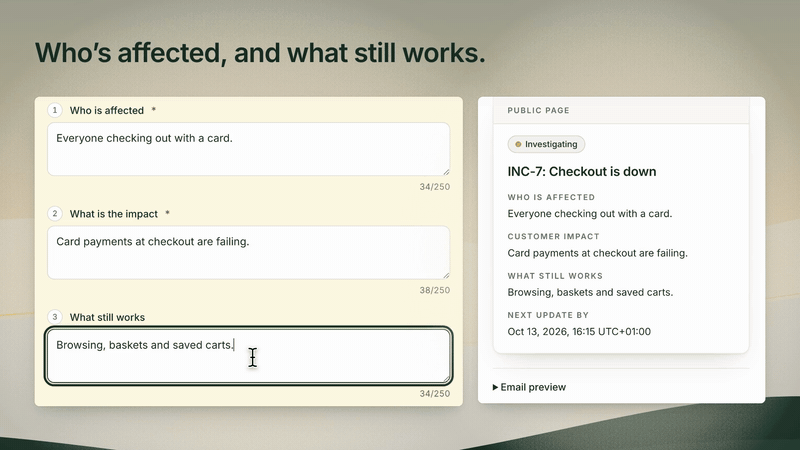
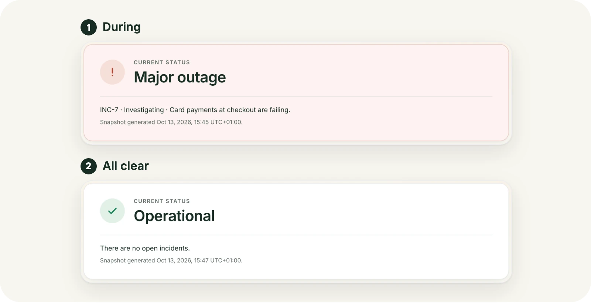
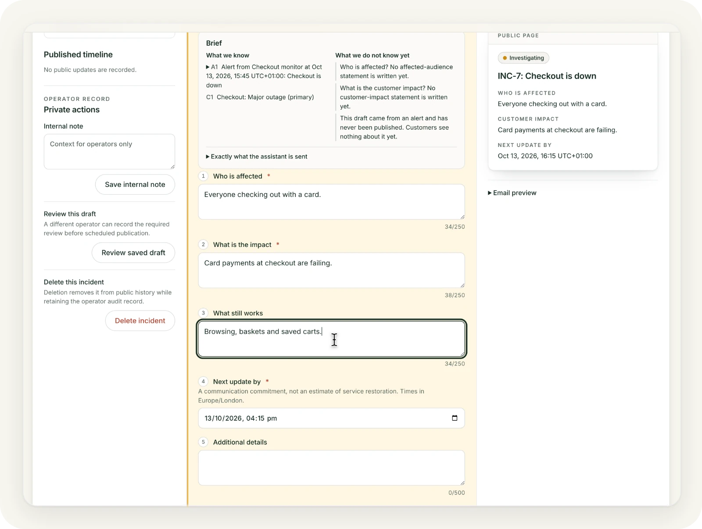
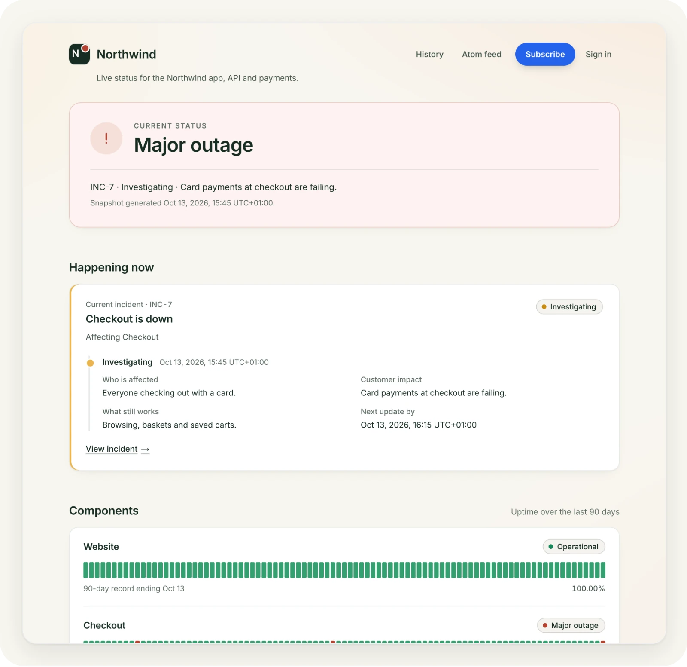

<p align="center">
  <a href="https://run-lamp.com">
    <picture>
      <source media="(prefers-color-scheme: dark)" srcset=".github/assets/banner-dark.webp">
      <source media="(prefers-color-scheme: light)" srcset=".github/assets/banner-light.webp">
      
    </picture>
  </a>
</p>

<p align="center"><a href="https://run-lamp.com">run-lamp.com</a> · <a href="https://justevery.com">Part of Just Every</a> · <a href="LICENSE">MIT licensed</a></p>

<p align="center">
  <a href="https://justevery.com/#vol-lamp"></a>
</p>
<p align="center"><a href="https://justevery.com/#vol-lamp"><b>Watch the full demo</b></a> · 51 seconds</p>

<p align="center">
  
</p>

<p align="center">
  <br>
  <sub>Write the update from a brief of what you know, with the public page previewed as you type.</sub>
</p>

<p align="center">
  <br>
  <sub>Customers see who is affected, what still works and when the next update is due.</sub>
</p>

# Lamp

Lamp is a self-hosted status page and incident communication desk for one
business. The operator app manages components, incidents, maintenance and
subscriber communication; its separate page host serves customer-facing status
information.

## Run it locally

```sh
npx -y @runeditrun/rer dev just-every/run-lamp
```

That one line installs `rer`, clones Lamp, sets up the first owner and starts it. To start it again later, run `cd run-lamp && rer dev`.

## Owner guides

The app host serves Lamp's public documentation at `/docs`. Start with the
[overview](docs/overview.md), then choose a task:

- [Install](docs/install.md) or [run Lamp locally](RUN-LOCALLY.md).
- [First-run setup](docs/first-run.md), [components and groups](docs/components-and-groups.md),
  [incidents and updates](docs/incidents-and-updates.md), and [maintenance](docs/maintenance.md).
- [Public page](docs/public-page.md), [subscribers and notifications](docs/subscribers-and-notifications.md),
  [monitoring alerts](docs/alerts-from-monitoring-tools.md), [AI assistance](docs/ai-assistance.md),
  and [operators](docs/operators-and-sign-in.md).
- [Domains](docs/domains.md), [move-in](docs/moving-in.md),
  [backups and recovery](docs/backups-and-recovery.md), and [updating](docs/updating.md).

## Source and tooling versions

The Run page's one line, `npx -y @runeditrun/rer dev just-every/run-lamp`,
clones `main` into a `run-lamp` folder and starts it; after that, run `rer dev`
from that folder. `main` is Lamp 1.6.0 development source, with changes not yet
in a release, and pins `@runeditrun/rer` 0.2.32. The latest tagged release is
`v1.5.1`, which pins rer 0.2.24. To use that release instead:

```sh
git clone --branch v1.5.1 https://github.com/just-every/run-lamp.git lamp
```

Then follow the documentation inside that checkout, which matches its tools.

Node 22.20.0 and pnpm 10.12.4 are pinned. `rer` downloads and uses that Node
version when your shell has a different one, and says so when it starts.

## Deploy and verify

- **Free:** you run Lamp's open source yourself in your own Cloudflare account,
  with no Run Edit Run charge. The commands in this guide are this path.
- **Assisted:** Run Edit Run installs and maintains Lamp for you, while it stays
  in your own Cloudflare account and GitHub repository (early access).
- **Managed:** Run Edit Run hosts and runs Lamp for you (waitlist only).

Compare them on [Run Edit Run plans](https://runeditrun.com/pricing).

Managed hosting includes mail: you need no provider account or mail key. RER
fills and hides `MAIL_PROVIDER=rer`, `MAIL_FROM`, `MAIL_RELAY_URL` and the private
`MAIL_API_KEY`. Free and Assisted hosting keep your own Resend or SendGrid account,
authenticated sender and API key, using `MAIL_FROM_ADDRESS`, `MAIL_DKIM_SELECTOR`
and `MAIL_PROVIDER_API_KEY`. Every hosted installation needs working mail. For
native deployment, save the required inputs in a private file outside the
checkout, owned by you with mode `0600`; follow the
[complete input-file example](docs/deploy.md#save-private-deployment-inputs).
You can also export the input names in the calling shell. The
[input reference](docs/deployment-reference.md) distinguishes required owner
values from secrets that `rer` generates on a first deploy.

Use `rer` from the project root; the checkout pins `@runeditrun/rer` 0.2.32. Before a
command that builds or verifies the checkout,
stop a running development server with `rer dev --stop` or a production preview
with `rer preview --stop`.

```sh
rer deploy --dry-run --environment production --env-file "$HOME/.config/lamp/production.env"
rer deploy --environment production --env-file "$HOME/.config/lamp/production.env"
```

The dry run validates and compiles locally without contacting Cloudflare. A
deployment validates owner inputs, provisions or reuses resources, applies
migrations, builds and uploads the Worker with secrets, and checks application health.
Run `rer verify` separately for the full source and browser checks; deployment does
not run the verifier. Follow the [deployment guide](docs/install.md)
for sender preparation and the [domain steps](docs/domains.md) before routing
visitors. For `workers.dev`, follow the
[hostname lookup and examples](docs/deployment-reference.md#find-your-workersdev-hostnames);
both host inputs remain required. Use the same environment on later deploys.
For terminal entry to the hosted owner account, use
`rer signin --environment production --env-file "$HOME/.config/lamp/production.env"`
from the deploying checkout with the default `lamp-<environment>` resource prefix.
It prints a private, single-use link without sending email; see
[terminal sign-in](docs/operators-and-sign-in.md#terminal-entry-for-the-hosted-owner)
for custom prefixes and other prerequisites.
To retire an installation, see the [removal command and record limits](docs/deploy.md#remove-an-installation).

Before `rer verify`, stop the active development server or production preview
with the corresponding command above. A passing source verifier does not
establish hosted readiness or provider delivery; record each installation's
acceptance evidence separately in [ACCEPTANCE.md](ACCEPTANCE.md).

## Your own domain

The public and operator hosts must be distinct. See [Hostnames and your own domain](docs/domains.md)
for Cloudflare zone and DNS steps.

## Maintainer references

- [CONTRACT.md](CONTRACT.md) defines Lamp's product behavior; [BASELINE.md](BASELINE.md)
  holds the shared security and data guarantees.
- [OPERATIONS.md](OPERATIONS.md) is the technical reference for Cloudflare
  provisioning, remote archives and recovery. Local data recovery uses the
  [canonical local sequence](RUN-LOCALLY.md#back-up-and-restore-local-data).
- [AUTHORING.md](AUTHORING.md) explains source selection and publication.
- [CHANGELOG.md](CHANGELOG.md), [RELEASE.json](RELEASE.json), and
  [HANDOVER.md](HANDOVER.md) record release and adoption information.

Preserve applied migration history. Back up data and the source revision before
an update, restore into an empty destination when needed, and verify the exact
candidate before adoption.
