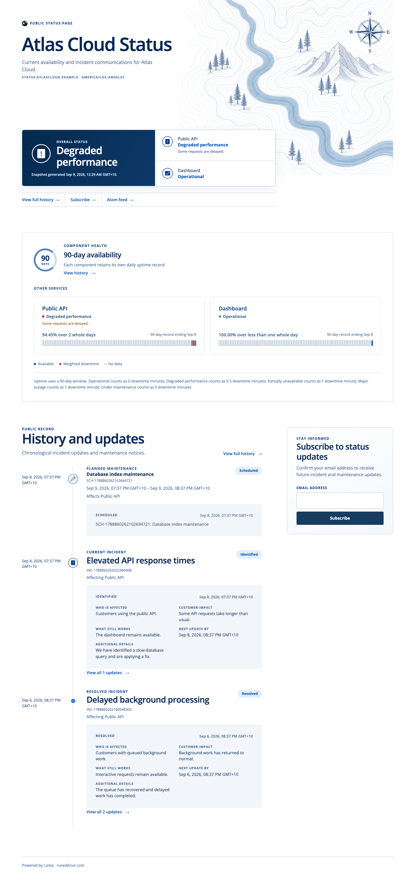
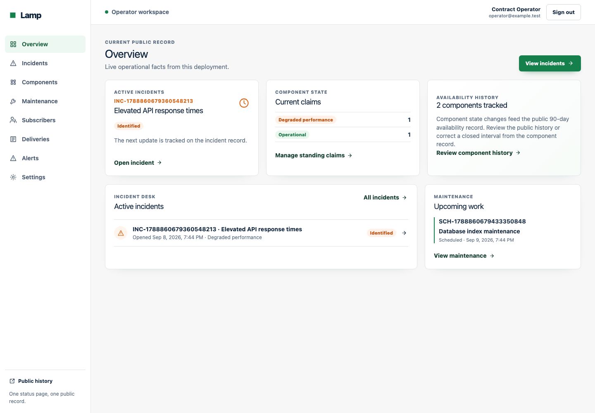

# Lamp

Lamp is a self-hosted status page and incident communication desk for one business. This repository is a **1.1.0 release candidate** with a real Cloudflare Worker, D1, R2, Queue runtime, generated setup configuration, and a schema-validated release record. Source verification, deployment and provider acceptance are separate outcomes; each adopting installation must record its own acceptance evidence.

The canonical source repository is [just-every/lamp](https://github.com/just-every/lamp). This source candidate does not establish publication of a release tag or acceptance of an installation.
This is the authoritative edition source for maintainers, owners and community
publishers. See [AUTHORING.md](AUTHORING.md) for source selection, local capability
publication and the shared workflow.

## Setup on your computer

Run `node scripts/install.mjs` with Node26.8.1. It opens the local browser setup
before installing dependencies. Review actual owner, page and provider details,
then Start to run Lamp locally. `--resume` retains your source edits and records.
The same setup can finish native initialization at your approved independent RER
operator address. Ordinary email sign-in is preserved; no session bypass exists.
See [independent operations](OPERATIONS.md#independent-release-and-local-browser-setup)
and [installer details](scripts/installer/README.md).

## Run locally

```sh
pnpm install
pnpm dev
```

The command applies local D1 migrations, starts Vite's local Cloudflare development Worker with the TanStack Start entry at `http://127.0.0.1:4177`, and on the first public request persists buyer-configured page settings and writes an empty public R2 snapshot. It does not create sample incidents, maintenance, subscribers, deliveries, or operator sessions.

- Public status page: `http://127.0.0.1:4177/`
- Public history: `http://127.0.0.1:4177/history`
- Feed and widget: `http://127.0.0.1:4177/feed.atom` and `http://127.0.0.1:4177/widget.js`
- Sign-in: `http://127.0.0.1:4177/signin`
- Protected operator app: `http://127.0.0.1:4177/app`
- Health: `http://127.0.0.1:4177/health`

`/app` and `/api/app/*` require a server-side operator session. End-to-end suites create real test-only session rows in isolated local D1 state; no runtime route or development switch creates a session.

`pnpm dev` explicitly selects local mail capture (`LAMP_DEV_OUTBOX_MODE=local`). On strict loopback hosts the development inbox at `/__dev/outbox` shows captured sign-in, subscription and notification envelopes. Use the actual links there to complete native authentication and confirmation; capture grants no session or subscription by itself. The inbox has its own local R2 bucket, excluded from product exports and production builds. Captured attempts are labelled locally captured, never provider accepted or delivered, and are not retried as provider sends.

Plain Vite without that mode has no development sender. With no configured provider, sign-in and subscription confirmation report mail unavailable, including an honest 503 for the script-disabled form. Production builds and previews never select the development inbox. The first allowed public-host request records its exact scheme and port for background notification links; a local state directory cannot silently switch that origin.

The local template maps both `LAMP_PAGE_HOST` and `LAMP_APP_HOST` to `127.0.0.1`. A deployment can use separate hostnames: public paths then belong only to the page host, while `/signin`, `/app`, `/_serverFn/`, `/app-assets`, `/api/app`, and `/health` belong only to the app host. TanStack Start renders the sign-in and authenticated operator documents; Hono remains authoritative for the API and R2-backed public artifacts.

## Local build

The operator app uses real D1 records for components, incidents, maintenance, subscribers, deliveries, settings, alerts, and operator management. Removing access and irreversible operator erasure are separate operations: erasure revokes access and removes personal values while retaining the opaque audit facts required to explain the action.

With no `ai.provider.v1` configured, the incident composer shows no suggestion control. If a configured provider fails, it surfaces the error without changing any other publication path.

Public surfaces are versioned R2 snapshot artifacts, so public reads do not query D1. The snapshot renderer produces the status page, history, feed, widget, permanent incident pages, favicon, Open Graph artwork, and bounded refresh payload. Initial HTML retains all public incident fields and remains usable without script.

The accepted public layout uses Open Sans, a pale full-width status band, open component rows with 90-day availability marks, and a vertical incident and maintenance chronology. Initial public HTML retains all real content and loads only same-origin assets; it never includes invented status records.

`pnpm run test:accessibility` runs Axe WCAG 2.2 AA checks in an isolated Worker against the real public, operator, and widget surfaces. It is automated local coverage and does not claim a manual accessibility evaluation. `pnpm run test:baseline` runs the local Workers baseline pack and records that Axe execution as `BASE-PUBLIC-003`.

## Visual references

The checked-in [`visual/`](visual/README.md) fixtures are curated from final local browser captures with test-owned data. They document the public status, history, permanent incident, sign-in, and operator surfaces at the listed viewport sizes; they are not deployment or tag proof.





The visual references document the implemented product. Generated design explorations are not runtime assets or evidence of deployment.

## Owner-controlled operations

A real setup needs owner-controlled `LAMP_PAGE_HOST`, `LAMP_APP_HOST`, page branding values, mail sender credentials, and verified DNS. `pnpm run setup` creates or reuses deterministic Cloudflare resources, writes generated `wrangler.toml`, applies migrations, and creates the initial operator and page settings. `pnpm build` emits the Start client under `dist/client/` and the generated Worker configuration at `dist/server/wrangler.json`. `CLOUDFLARE_ACCOUNT_ID` and `CLOUDFLARE_API_TOKEN` are required for owner-controlled setup, deployment, and remote archive operations. `pnpm run deploy -- --dry-run` compiles the generated two-host configuration and artifact without contacting Cloudflare.

`pnpm run export` writes every D1 entity as JSON and every R2 object with its original bytes and content type. `pnpm run import` restores an archive only into an empty deployment after applying migrations. See [OPERATIONS.md](OPERATIONS.md) for provider setup, private backups, owner migrations and recovery into a fresh destination.

Run the local verifier with:

```sh
pnpm verify
```

The coverage gate fails if a `CONTRACT.md` clause lacks a meaningful tagged behavior test. The final tag identity and clean-clone verifier result are recorded externally once the source is frozen. See [TESTING.md](TESTING.md) for verification journeys and [HANDOVER.md](HANDOVER.md) for adoption and migration guidance.

Browser journeys use the pinned Playwright package. Install Chromium once in a fresh clone before running them:

```sh
pnpm exec playwright install chromium
```

## Customise and share improvements

The maintained edition defaults save integration and verification work. Configuration
and hooks are conveniences; editing domain internals, core schema, UI, framework
or infrastructure is ordinary authoring too. Choose the change that serves the
owner's outcome, without a required sequence of extension mechanisms. Complex
merges and adaptation are the agent's work. Preserve the owner's actual requirements
wherever recorded: `CONTRACT.md`, `DIVERGENCE.md`, owner instructions and optional
`.seed/intent.md`; no particular intent file or registry is required.

Feed useful mechanisms, defaults and verification cases back into shared source
when they would save work in another edition. Their natural home may be this
edition, a family, Base or an independent repository; no separate repository per
module or universal compatibility interface is required. Verify adoption against
the receiving product's requirements, including deliberate local differences.

## Shared source refactor

The edition carries editable shared SendGrid transport and authoring1.1 source.
`node scripts/edition-authoring/cli.mjs changes` explains changed inputs;
`extract` and `compare` provide retained source and incoming comparison context.
`release` writes an adjacent `.release.json` receipt; retain that sidecar with
source distribution and use `receipt <path>` to verify another clean clone.
See [AUTHORING.md](AUTHORING.md) for arguments and source-only verification limits.

SendGrid202 is accepted with a nullable actual provider receipt. Local correlation
identifies the command, not remote delivery. Uncertain submissions are reconciled
without automatic repetition; the edition retains its own durable policy.

Owner SQL in `migrations/ext/` runs after core through the actual local and deployment migration commands. Preserve applied histories; `pnpm run test:owner-migrations` tests real isolated D1 execution and recovery. See [migrations/README.md](migrations/README.md).
